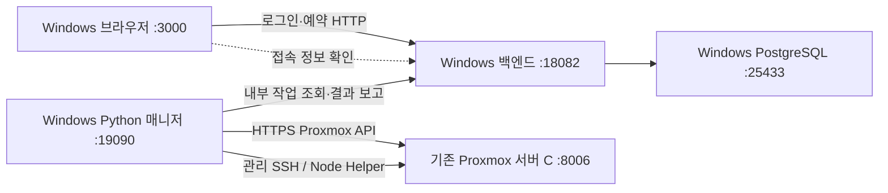

# Windows 관리 PC 통합 개발·실행 인수인계

점검일: **2026-10-31 / Asia/Seoul**

이 문서는 현재 PC에서 읽기 전용으로 확인한 사실과, 향후 Windows 관리 PC 한 대에 프론트·백엔드·매니저를 함께 배치하는 제안을 구분한다. Proxmox 대여 서버 C는 유지한다. 이번 점검에서는 기존 소스·설정·DB를 변경하지 않았고 서비스 시작·종료·재시작, 의존성 설치, 빌드·테스트 재실행, 예약·VM 작업을 수행하지 않았다. 새 인수인계 문서와 비밀값이 없는 점검 기록만 작성했다.

## 우선 전달할 결론

1. 프론트는 Git의 `main` / `e8991a85d5275e07521f1212179b1ecaf92dde3d`이며 점검 시작 당시 미커밋 변경이 없었다.
2. 현재 셸의 Node.js는 **22.14.0**, npm은 **10.9.2**다. 프론트 실행 스크립트는 3000 포트를 사용한다.
3. 프론트 `.env`와 기존 웹 빌드에는 `https://herbal-ribcage-basics.ngrok-free.dev`가 설정되어 있다. 해당 주소의 `/health`는 이번 점검에서 **HTTP 404**였다. 터널·현재 배포본의 정상 동작을 확인한 상태가 아니다.
4. Desktop 백엔드는 **API 0.2.0 전달본**이다. `/formLogin`, `/refresh`가 명세에 없고 로그인 구현도 찾지 못했다. 프론트가 사용하는 **0.5.0 전달 폴더에는 `docs`만 있고 백엔드 소스는 없다.** 최신 실행 백엔드 소스와 실제 DB·비공개 설정 확보가 먼저다.
5. 현재 Java는 **17.0.12**이고 `JAVA_HOME`도 JDK 17이다. 전달 백엔드의 `pom.xml`은 **Java 21**을 요구한다. `mvn.cmd`는 현재 PATH에서 찾지 못했다.
6. 현재 Python은 **3.13.7**이지만 `py -0p`는 등록된 Python을 찾지 못했다. `passlib`도 현재 Python에 설치되어 있지 않다. 전달 매니저의 `.local/config.json`, `.local/state.sqlite3`도 없다.
7. 점검한 로컬 포트 3000·3001·18080·18081·18082·19090·25433·15433·5432에는 리스너가 없었다. 8080 리스너는 Docker Desktop의 `com.docker.backend`였다. 관련 Node/Java/Python 프로세스 목록에서도 세 프로젝트의 실행을 확인하지 못했다. 이는 점검 시점의 이 PC 관측이며 다른 PC·원격 장비의 실행 상태를 뜻하지 않는다.

## 1. 실제 프로젝트 경로와 Git·전달 상태

| 구분 | 확인한 실제 경로 | Git·버전 상태 |
| --- | --- | --- |
| 프론트 | `C:\Users\gwkim\Documents\ChatGPT\캡디` | Git 저장소, `main`, 커밋 `e8991a85d5275e07521f1212179b1ecaf92dde3d` |
| 백엔드 소스 전달본 | `C:\Users\gwkim\Desktop\server-allday-backend` | Git 저장소 아님. 명세·전달 매니페스트 0.2.0. Git 브랜치·커밋·미커밋 diff는 확인 불가 |
| Windows 매니저 소스 전달본 | `C:\Users\gwkim\Desktop\server-allday-manager` | Git 저장소 아님. `TRANSFER_MANIFEST.json`의 버전 0.1.0, 생성일 2026-10-27. Node Helper v0.2 연결 드라이버 포함 |
| 프론트용 API 0.5.0 문서 | `C:\Users\gwkim\Desktop\Server_Allday_프론트_API_전달_0.5.0_2026-10-14\server-allday-backend\docs` | 문서 전달 폴더. `src`, `pom.xml`, 실행 프로젝트는 없음 |

프론트 origin: `https://github.com/serverallday/serverAllDay_FE.git`.
커밋 메시지: `feat: initialize Server Allday frontend`, 커밋일 2026-10-29.
원격 브랜치를 이번에 fetch하거나 변경하지 않았다. 기록은 로컬 Git 기준이다.

전달본 무결성은 매니페스트에 기재된 파일의 SHA-256으로 확인했다.

- 백엔드 `DELIVERY_MANIFEST.json`: 기재 파일 **82개 일치**, 변경 0개, 누락 0개.
- 매니저 `TRANSFER_MANIFEST.json`: 기재 파일 **63개 일치**, 변경 0개, 누락 0개.
- 이는 기재 파일에 대한 비교이며 Git 이력이나 배포본과의 동일성을 보증하지 않는다. 매니페스트 밖의 빌드 결과·런타임 파일 전체까지 버전 관리한 결과는 아니다.
- 매니저 매니페스트의 `windowsExecutionVerified`, `realHardwareVerified`는 모두 false다. 전달본의 과거 시험 기록을 현재 장비 검증으로 취급하지 않는다.

### Git에 없는 필수 파일과 인계 대상

| 파일·자료 | 현재 확인 | 이관 시 처리 |
| --- | --- | --- |
| 프론트 루트 `.env` | 존재, Git 제외. 키는 `EXPO_PUBLIC_API_URL` 한 개 | Windows용 로컬 API 주소로 새로 작성. 비밀 토큰을 넣지 않음 |
| 프론트 `node_modules`, `.expo`, `dist` | 존재, Git 제외 | 원본 이관 필수 아님. `npm ci` 및 웹 빌드로 재생성 |
| 프론트 로고·웹 로고 모듈·폰트·폰트 라이선스·`package-lock.json` | Git에 포함 | clone에 포함됨. 임의로 제외하지 않음 |
| 최신 실행 백엔드의 **소스 저장소·브랜치·커밋** | 이 PC 전달본에서 확보 못 함 | 백엔드 담당자에게 API 0.5.0 이상 실제 실행 버전을 요청 |
| 최신 백엔드의 비공개 DB/JWT/worker/암호화 키 설정 | 실행 설정을 확보 못 함. Desktop `.local/development.json`, `.env` 없음 | 값은 비공개 경로로 전달. 이름은 최신 `application.yml`과 대조 |
| 기존 서비스 DB의 논리 백업·복원 정보 | 확보 못 함 | 기존 계약·작업·자원 할당을 유지해야 하면 DB와 암호화 키를 함께 인계. 빈 DB로 운영 C를 바로 제어하지 않음 |
| 매니저 `.local/config.json` | Desktop 전달본에 없음 | 실제 운영 매니저의 설정을 비공개로 인계. 예제 파일과 혼동하지 않음 |
| 매니저 `.local/state.sqlite3` 및 진행 중 작업 상태 | Desktop 전달본에 없음 | 기존 `commandId`, UPID, UNKNOWN 및 helper revision 상태를 유지하는 이관 절차 필요. SQLite 사용 중 원본 파일 한 개만 무작정 복사하지 않음 |
| `manager-connection.json` | Desktop 전달본에서 발견 못 함 | 백엔드 주소와 worker 인증을 담는 비공개 파일. Git·프론트·공개 ZIP에 넣지 않음 |
| Proxmox CA 파일 | 실제 경로·파일 확보 못 함 | 매니저 `proxmox.ca_file`이 가리키는 공개 CA 파일을 준비 |
| helper SSH 개인키·`known_hosts` | 실제 경로·파일 확보 못 함 | `nodes.<serverId>.helper.key_file`, `known_hosts_file` 경로를 Windows 경로로 설정. 실제 개인키는 비공개 전달 |
| 사용자 로그인 비밀번호·브라우저 refresh/access 토큰 | 수집하지 않음 | 이관 자료로 복사하지 않고 새 환경에서 로그인 |

기존 정리 보관 폴더 `.local-only/cleanup-2026-10-29/`에는 과거 Node Helper 원본·패키지·PDF 등이 있다. 프론트 실행이나 최신 관리 서버의 실설정으로 사용하지 않는다. 이 폴더는 계속 Git 제외다.

점검 시작 시 프론트 working tree는 clean이었다. 이 인수인계 작업으로 생긴 미커밋 파일은 이 문서와 `docs/evidence/windows-development-environment-2026-10-31.json`뿐이어야 한다. 이번에는 커밋·푸시하지 않는다.

## 2. 실제 런타임과 명령

### 프론트 런타임

| 항목 | 확인한 값 |
| --- | --- |
| Node | `v22.14.0`, `C:\Program Files\nodejs\node.exe` |
| npm | `10.9.2`, `C:\Program Files\nodejs\npm.cmd` |
| Expo 설치 버전 | 54.0.37 |
| React / React DOM | 19.1.0 / 19.1.0 |
| React Native / React Native Web | 0.81.5 / 0.21.3 |
| NativeWind / Tailwind | 4.2.7 / 3.4.19 |
| Reanimated / Worklets | 4.1.7 / 0.5.1 |
| babel-preset-expo | 54.0.12 |
| Expo Clipboard | 8.0.8 |
| Safe Area Context / React Native SVG | 5.6.2 / 15.12.1 |
| 점검에 사용한 PowerShell | 7.6.5 |

버전은 `node --version`, `npm.cmd --version`, `npm.cmd ls --depth=0` 및 설치 패키지에서 확인했다. 과거 빌드 프로세스의 실행 파일까지 소급 증명한 것은 아니며, 이 PC에서 현재 재현에 사용할 수 있는 터미널 런타임이다. 다른 Codex 내부 도구의 bundled Node는 프로젝트 실행 버전과 구분한다.

React Native 0.81과 설치 Metro의 Node 조건은 `>=20.19.4`이며 현재 Node 22.14.0은 이를 충족한다. 처음 이관할 때는 Node/npm과 lockfile을 맞추고 의존성을 임의 업그레이드하지 않는다. [React Native 공식 안내](https://reactnative.dev/blog/2025/08/12/react-native-0.81)

### 프론트 명령 — 아래는 이관 후 실행 예제이며 이번에 재실행하지 않음

```powershell
Set-Location 'C:\ServerAllday\serverAllDay_FE'
node --version
npm.cmd --version
npm.cmd ci

# .env가 없을 때만 예시 복사. 이후 API 주소를 직접 확인·수정한다.
if (-not (Test-Path .env)) { Copy-Item .env.example .env }

# 개발용: 이 PC에서만 브라우저 접근
npm.cmd run web -- --localhost
```

| 목적 | 명령 | 동작·주의 |
| --- | --- | --- |
| 의존성 재현 설치 | `npm.cmd ci` | `package-lock.json` 사용. 다른 PC의 node_modules를 복사하지 않음 |
| Expo 웹 개발 | `npm.cmd run web -- --localhost` | 3000. `preweb`에서 로고 동기화 |
| 대체 개발 포트 | `npx.cmd expo start --web --localhost --port 3001` | CORS에 3001 Origin 추가 필요. 직접 expo를 실행하므로 PNG 변경 시 먼저 `npm.cmd run sync:logo` |
| 일반 Expo 시작 | `npm.cmd start` | 3000, 웹 전용 시작과 구분 |
| 웹 정적 빌드 | `npm.cmd run build:web` | `prebuild:web` 로고 동기화 후 `dist` 생성 |
| 빌드된 웹 실행 | `npm.cmd run preview:web` | 기존 dist를 127.0.0.1:3000에서 제공. env를 새로 반영하거나 다시 빌드하지 않음 |
| 빌드 후 웹 실행 | `npm.cmd run web:fast` | 빌드 완료 후 정적 미리보기. 개발 서버와 동시에 같은 포트 사용 불가 |
| 자동 시험 | `npm.cmd test` | Node 테스트. 일부는 로컬 임시 HTTP 포트 사용 |
| 오프라인 계약 점검 | `node scripts/audit-api.cjs` | 실제 로그인·VM 요청 아님. `artifacts/api-audit.json` 생성 |

직전 2026-10-29 기록은 자동 시험 **93개 통과**, 오프라인 감사 6개 통과, 웹 export 성공이다. 이번에는 설치·빌드·시험을 재실행하지 않았다. 과거 샌드박스에서 로컬 HTTP 시험이 EACCES였던 것은 샌드박스 제한으로, 승인된 재실행에서 통과했다.

### 백엔드·매니저 런타임 현황

- Java: `17.0.12`, `JAVA_HOME=C:\Program Files\Java\jdk-17`. 전달 백엔드는 Java 21 필요. Maven은 PATH에 없음.
- Python: `3.13.7`, `C:\Users\gwkim\AppData\Local\Programs\Python\Python313\python.exe`. `py.exe`는 있으나 `py -0p` 결과는 `No installed Pythons found!`. `python` 실행과 `py -3` 실행을 동일하게 가정하지 말 것.
- 현재 Python에 `passlib` 없음. 매니저 `requirements.txt`는 hash가 지정된 `passlib==1.7.4`를 요구함.
- Windows OpenSSH: `C:\WINDOWS\System32\OpenSSH\ssh.exe` 발견.
- Docker CLI: `29.8.1` 발견. 컨테이너 목록·DB 내용은 이번에 조회하지 않았으며 프로젝트 컨테이너 실행 성공으로 보지 않음.

백엔드 소스 확보·JDK 21·Maven·DB 역할 및 비공개 환경 변수를 준비한 뒤의 명령 예시는 다음과 같다. 현재 소스를 실행해도 프론트 0.5.0 로그인 계약이 충족되는 것은 아니다.

```powershell
Set-Location 'C:\ServerAllday\server-allday-backend'
java -version   # 21인지 확인
mvn.cmd -version
mvn.cmd -B -ntp -DskipTests package
java -jar '.\target\server-allday-backend-0.1.0.jar'
```

JAR 이름은 확인한 전달본 기준이다. 최신 소스의 `pom.xml`과 생성 JAR 이름으로 맞춰야 한다. DB가 필요한 Maven 시험은 별도 시험 DB 연결을 확인한 뒤 수행한다. 기존 `scripts/local.py test`는 시험 DB를 초기화하므로 이관 점검용으로 운영 DB에 실행하지 않는다.

매니저는 승인된 비공개 실설정을 복원한 뒤 고정된 가상환경 Python으로 실행하는 경로를 권장한다.

```powershell
Set-Location 'C:\ServerAllday\server-allday-manager'
python -m venv .venv
.\.venv\Scripts\python.exe -m pip install --require-hashes -r requirements.txt
.\.venv\Scripts\python.exe scripts/local.py check-config
# check-config는 설정 검사이며 실제 장비 연결 성공을 보장하지 않는다.
# 다음 명령은 실장비 작업을 가져가므로 절체 승인·중복 매니저 확인 후에만 실행한다.
.\.venv\Scripts\python.exe -m manager.server --config .local/config.json
```

예제의 `python`은 현재 3.13.7이다. 다른 Python을 선택하면 그 실행 파일의 절대 경로로 venv를 생성한다. `start-manager.ps1`은 `py -3`를 사용하므로 현재 launcher 문제를 해결하지 않으면 실패할 수 있다. `setup`은 기본 DEMO 설정을 생성할 수 있어, 실제 설정을 복원하지 않은 채 실장비 준비 완료로 간주하지 않는다.

## 3. 현재 API·포트·설정 우선순위

| 항목 | 현재 파일·코드 값 | 이번 실행 관측 |
| --- | --- | --- |
| 프론트 `.env` API | `https://herbal-ribcage-basics.ngrok-free.dev` | `/health` HTTP 404 |
| 프론트 `.env.example` | `http://127.0.0.1:18082` | 공유용 예시 |
| `App.jsx`, `src/api.js` 기본 API | `http://127.0.0.1:18082` | 환경 변수·입력 주소가 없을 때 기본값 |
| 현재 dist 안 API | 위 ngrok 주소 포함 | dist/index.html 생성 시각 2026-10-29 15:37:42 KST |
| 프론트 웹/정적 미리보기 | 3000 | 현재 리스너 없음 |
| 백엔드 전달본 application 기본 | 127.0.0.1:18080 | 현재 리스너 없음 |
| 전달본 Docker API 매핑 | 127.0.0.1:18081 → 컨테이너 18080 | 이 구성으로 기동하지 않음 |
| 전달본 로컬 DB 스크립트 | 127.0.0.1:25433 | 현재 리스너 없음 |
| 전달본 Docker DB 매핑 | 127.0.0.1:15433 → 컨테이너 5432 | 해당 DB의 존재·내용 미확인 |
| 매니저 예시 | 127.0.0.1:19090, backend_url은 ngrok | 실제 `.local/config.json` 없음, 리스너 없음 |

프론트 소스에서 읽는 앱 환경 변수는 **`EXPO_PUBLIC_API_URL`**이다. 현재 검사 셸의 `EXPO_PUBLIC_API_URL`, `EXPO_OFFLINE`은 unset이었다. `.env`를 Expo가 시작·빌드 시 로드한다. `EXPO_PUBLIC_*`는 브라우저 번들에 공개되므로 비밀값을 넣으면 안 된다. [Expo 환경 변수 안내](https://docs.expo.dev/guides/environment-variables/)

로그인 화면의 API 주소 입력으로 기본 주소를 바꿀 수 있다. 로그인 후에는 sessionStorage의 `server-allday.web-session.v1`에 저장한 **baseUrl**로 세션을 복원한다. 따라서 `.env`만 바꿔도 기존 탭이 이전 API에 `/refresh`를 보낼 수 있다. 이관 시 앱에서 로그아웃하거나 새 세션으로 열고, 필요하면 해당 앱의 저장 세션을 제거한 뒤 다시 로그인한다. 저장소의 토큰 값을 화면 캡처·보고서로 복사하지 않는다. 이번에는 브라우저 저장소를 읽지 않았으므로 사용자가 입력한 현재 탭의 API override는 확인하지 못했다.

프론트 설정 파일: `.env`(비공개 로컬), `.env.example`, `app.json`, `package.json`, `package-lock.json`, `babel.config.js`, `metro.config.js`, `tailwind.config.js`, `global.css`. 정적 서버는 `scripts/preview.cjs`이며 API 프록시가 없다. API 요청은 브라우저에서 백엔드의 절대 주소로 직접 간다.

## 4. Windows 한 대에 함께 배치할 설정 제안

아래는 **변경 제안**이며 현재 설정을 바꾸지 않았다. C의 주소·템플릿·네트워크·헬퍼는 기존 승인 설정을 유지한다.

```text
C:\ServerAllday\
  serverAllDay_FE\             # 프론트 Git clone
  server-allday-backend\       # 실제 실행 버전의 최신 소스
  server-allday-manager\       # 실제 실행 버전의 최신 소스
  private\                    # 비공개 연결 설정·키·CA·known_hosts
```



브라우저가 Proxmox 토큰으로 C의 API에 접속하거나 매니저의 내부 작업 API를 직접 호출하는 구조가 아니다. 실제 VM SSH는 제공받은 SSH 클라이언트/터널 명령을 사용한다.

### 프론트 `.env` 예시

```dotenv
EXPO_PUBLIC_API_URL=http://127.0.0.1:18082
```

이관 후 `.env`와 로그인 화면의 주소를 맞추고 개발 화면을 새로 로드한다. 정적 웹은 **다시 빌드**해야 새 API 기본 주소가 포함된다. `preview:web` 실행만으로 예전 ngrok 주소가 교체되지 않는다.

### 백엔드 설정 예시 — 값은 비공개로 주입

아래는 확인한 전달본에 있는 변수 이름을 사용하는 예시다. 최신 백엔드의 JWT·인증 변수 이름은 최신 소스를 받은 후 추가 확인해야 하며 여기서 임의로 만들지 않았다.

```dotenv
API_BIND_ADDRESS=127.0.0.1
API_PORT=18082
DB_URL=jdbc:postgresql://127.0.0.1:25433/capdi_dev
DB_USER=capdi_app
DB_PASSWORD=<PRIVATE_APP_DB_PASSWORD>
DB_MIGRATION_USER=capdi_owner
DB_MIGRATION_PASSWORD=<PRIVATE_MIGRATION_DB_PASSWORD>
WORKER_TOKEN=<EXISTING_OR_COORDINATED_PRIVATE_WORKER_TOKEN>
CREDENTIAL_KEY=<KEY_MATCHING_THE_RESTORED_DATABASE>
CORS_ORIGIN=http://127.0.0.1:3000
SCHEDULER_ENABLED=true
DEV_AUTH_ENABLED=false
DEV_SEED_ENABLED=false
```

`DB_*`, `WORKER_TOKEN`, `CREDENTIAL_KEY`는 이 문서의 자리표시자를 실제 값으로 실행하라는 의미가 아니다. 기존 DB의 암호화 키와 worker 인증을 맞춰 비공개로 주입한다. `.env`를 파일로 만들기만 해서는 Spring Boot가 자동으로 읽지 않는다. IDE Run Configuration, 프로세스 환경 변수 또는 확인한 Compose 설정의 env 주입을 사용한다. `DEV_AUTH_ENABLED=false` 상태에서도 로그인하려면 최신 실제 인증 구현이 있어야 한다.

**구 전달본의 `scripts/local.py start`는 위 포트 예시를 그대로 따르지 않는다.** APIPORT를 18080으로 고정하고, 로컬 실행 환경에서 DEV_AUTH/DEV_SEED를 true로 덮어쓴다. 백엔드 담당자가 Windows용 실행 경로를 확인하기 전에는 이 스크립트를 실장비 C 통합 실행기로 사용하지 않는다. Docker 전달 설정도 API 18081·DEMO 인증/seed 구성이라 별도 확인 대상이다.

### 매니저 설정에서 바꿀 부분

아래는 **기존 실설정에 대조할 항목 목록**이며 실행 가능한 전체 config가 아니다. 예제만 복사하여 나머지 노드·토큰·헬퍼 설정을 지우면 안 된다.

```json
{
  "backend_url": "http://127.0.0.1:18082",
  "bind": "127.0.0.1",
  "port": 19090,
  "state_path": "C:/ServerAllday/server-allday-manager/.local/state.sqlite3"
}
```

- 기존 `mode`, `worker_id`, `worker_token`, `agent_token`, `server_ids`, `gateway_protocol`, `nodes`, `proxmox` 설정과 진행 상태는 보존·대조한다.
- 매니저 HttpClient는 loopback HTTP를 허용하므로 같은 Windows 호스트에서 직접 실행하는 백엔드에는 위 주소를 사용할 수 있다. C의 Proxmox API 주소를 backend_url에 넣지 않는다.
- `proxmox.ca_file`, `helper.key_file`, `helper.known_hosts_file`은 Windows에 실제 존재하는 경로로 맞춘다. JSON 경로는 `C:/...` 또는 역슬래시 이스케이프를 사용한다.
- JSON은 UTF-8 **BOM 없이** 저장한다. 확인한 load_config는 `Path.read_text()` 후 json.loads를 사용하며 BOM 처리와 Windows 기본 인코딩에 유의해야 한다.
- 컨테이너 안의 loopback은 Windows 호스트가 아니다. 백엔드만 Docker이면 Windows에 공개한 API 포트로 매니저를 연결한다. 백엔드 컨테이너→DB는 Compose 서비스명/컨테이너 내부 포트를 사용한다.
- 서버별 SSH host/port는 기존 C의 접속 경로다. 프론트/API를 loopback으로 바꾼다고 학생 SSH 주소까지 127.0.0.1로 바꾸지 않는다.

### 백엔드 담당자에게 요청할 CORS Origin

| 우선순위 | Origin | 용도 |
| --- | --- | --- |
| 기본 허용 | `http://127.0.0.1:3000` | 정적 preview와 권장 로컬 개발 주소 |
| 함께 허용 | `http://localhost:3000` | localhost로 여는 개발 화면 |
| 3001 사용 시 | `http://127.0.0.1:3001` | 대체 개발 포트 |
| 3001 사용 시 | `http://localhost:3001` | 대체 개발 포트의 localhost |
| 다른 PC 브라우저 접근 시만 | `http://<WINDOWS_PC_LAN_IP>:3000` | 실제 LAN IP로 확정 후 추가 |

Origin에는 경로·끝 슬래시를 붙이지 않는다. 같은 PC만 사용할 때 LAN Origin은 필요 없다. 사용하지 않는 5173 등의 포트를 관성적으로 추가하지 않는다. API 주소나 Proxmox 8006, 매니저 19090을 프론트 Origin으로 등록할 필요도 없다.

**확인한 0.2.0 WebConfiguration의 구체적인 제약:**

1. `setAllowedOrigins(List.of(origin))`여서 쉼표로 여러 Origin을 한 문자열에 넣어도 목록으로 분리하지 않는다. 최신 백엔드에서 명시적 배열/분리 처리를 요청한다.
2. CORS 필터 등록이 `/api/**`뿐이다. 프론트가 쓰는 `/formLogin`, `/refresh`, `/logoutProc`, `/mypage`에도 적용되어야 한다. 해당 인증 경로의 OPTIONS와 실제 응답 모두 확인한다.
3. 메서드: `GET, POST, PUT, PATCH, DELETE, OPTIONS`. 헤더: `Authorization, Content-Type, Idempotency-Key`. ngrok을 계속 쓰는 경우 `ngrok-skip-browser-warning`도 허용해야 한다. 현재 구 소스에는 이 헤더가 없다.
4. 노출 응답 헤더: `X-Request-Id`, `Location`. 현재 프론트는 `credentials: 'omit'` 및 Bearer 방식이므로 쿠키용 allowCredentials=true를 추가할 필요는 없다. 인증 방식 변경은 별도 계약 사항이다.

CORS는 브라우저↔백엔드 문제다. 매니저↔백엔드 인증 오류, Proxmox ACL/VMID 오류를 CORS 설정으로 해결할 수 없다.

## 5. 프론트가 사용하는 API와 계약

기준: `src/api.js`, `App.jsx`, `tests/contracts/public-api.json`의 **0.5.0**. 일반 API는 access Bearer, JSON 요청은 application/json이며 204는 빈 성공으로 처리한다. 응답에는 실패 HTTP status·code·message와 가능한 requestId를 유지한다.

| 흐름 | API | 요청·응답에서 맞출 사항 |
| --- | --- | --- |
| 로그인 | `POST /formLogin` | form-urlencoded: username, password, largeLogin=false → accessToken, refreshToken |
| 신원·역할 | `GET /api/v1/me` | memberId, role=STUDENT/ADMIN, authorities, rentalEligible. 서버 검증 결과로 UI 제한 |
| 표시용 프로필 | `GET /mypage` | 현재 memberId와 일치하는 nickname만 사용. 권한 근거로 사용하지 않음 |
| 갱신 | `POST /refresh` | JSON refreshToken → 새 access/refresh 쌍. 동시 401은 갱신 공유 후 원 요청 한 번 재시도 |
| 로그아웃 | `POST /logoutProc` | access Bearer + JSON refreshToken. 로컬 세션은 요청 실패에도 제거 |
| 분류·서버 | `GET /api/v1/categories`, `GET /api/v1/servers` | 실제 목록·상태·version·예약 가능 여부 |
| 달력 가용 시간 | `GET /api/v1/servers/{id}/availability?from=...&to=...` | blockedSlots, 가능한 경우 serverNow/reservationHorizonAt/minimumSwitchSeconds |
| 예약 사전검사 | `POST /api/v1/rental-previews` | serverId, purpose, slots[{startAt,endAt}] → serverAvailable, canReserve, slots, conflicts |
| 예약 확정 | `POST /api/v1/rentals` | 사전검사한 신청 본문 + Idempotency-Key. 실제 생성은 비동기 작업 |
| 내 대여·상태 | `GET /api/v1/rentals?limit=100&offset=0`, `GET /api/v1/rentals/{id}` | 현재 status/version, 기간, 서버 snapshot, 진행 요약. 브라우저가 임의 완료 처리하지 않음 |
| 접속 정보 | `GET /api/v1/rentals/{id}/connection` | available=true일 때 host/port/username/sshCommand 및 선택 jupyterTunnelCommand 표시 |
| 암호 보기 | `GET /api/v1/rentals/{id}/credential` | 사용자가 보기 요청할 때만. 닫기·계정/상태 변경 시 화면에서 폐기 |
| 반납 | `POST /api/v1/rentals/{id}/return` | expectedVersion, reason, Idempotency-Key. 접수와 실제 정리 완료를 구분 |
| 예약 취소 | `POST /api/v1/rentals/{id}/cancel` | expectedVersion, reason, Idempotency-Key |
| 관리자 강제 반납 | `POST /api/v1/admin/rentals/{id}/force-return` | 선택한 대여 ID/version/reason + Idempotency-Key |
| 관리자 내부 사유 로그 | `GET /api/v1/admin/events?limit=100` | 관리자만 조회. 사용자 화면에는 마지막 확인·내부 reasonCode 비노출 |

계약 클라이언트에는 credential-resets와 rental events도 있지만 기본 사용자 화면에서 모든 API를 자동 호출하는 것은 아니다. 사용자 SSH 공개키 입력·관리 화면은 없다. mock 서버로 실제 로그인·VM 실행을 대체하지 않는다.

오전은 한국 시간 08:00–15:00, 오후는 16:00–23:00의 **날짜별 개별 슬롯**이다. 장기 대여는 시작일 00:00부터 종료일 다음 날 00:00까지 연속 슬롯이다. 저장·전송에서는 시간대 오프셋을 유지하고 UTC Z 응답과 같은 순간으로 비교한다.

### 아직 해결 여부를 확인하지 못한 연동 문제

| 항목 | 확인된 근거 | 다음 확인·담당 |
| --- | --- | --- |
| 실제 최신 백엔드 소스 부재 | 0.5.0 폴더는 docs만, 소스 전달본은 0.2.0 | 백엔드: 실제 배포 소스·커밋·환경 변수·DB 버전 인계 |
| 기존 API 주소 유효성 | 2026-10-31 ngrok `/health` 404 | 백엔드: 실제 API 주소/health/auth 경로 확인. 404만으로 모든 경로가 죽었다고 단정하지 않음 |
| CORS 범위·다중 Origin | 구 소스는 `/api/**` 단일 문자열 Origin | 최신 백엔드에서 인증 경로·OPTIONS·Origin 목록을 확인/보완 |
| preview가 신청 슬롯 변경 | 사용자가 11/1–11/5 오후를 보냈으나 이전 응답의 첫 시작이 10/28 오전으로 확장됨 | 기존 `백엔드_예약_preview_슬롯변경_수정요청서_2026-10-28.md`와 evidence를 인계. 프론트는 PREVIEW_SLOT_MISMATCH로 확정 중단. 백엔드 수정 완료/현재 재현 여부 미확인 |
| VMID·권한·반복 BLOCKED | 실제 최초 Proxmox 오류 문구를 확보하지 못함 | 매니저/인프라: 실행본 clone pool 전달, 템플릿·저장소·토큰 ACL, 기존 UNKNOWN을 실자원과 대조 |
| 풀 지정 실행본 차이 | 이 PC 매니저의 복제 요청에는 pool/vm_pool 없음. 다른 확인 답변에는 allday-node57 전달이 있다고 함 | 배포 PC의 실제 파일·커밋·설정을 받아 비교. 이 전달본을 최신으로 덮어쓰지 않음 |
| 매니저 상세 오류 부족 | 로컬 PveClient는 HTTP 오류 본문을 PVE_HTTP_ERROR로 축약. UNKNOWN은 같은 서버 후속 작업 차단 | 최초 PVE 오류·UPID와 operation reason을 보존하여 운영 절차로 복구. DB 기록 삭제로 우회하지 않음 |
| 카테고리 추가/수정/삭제 UI | BACKLOG.md에 사용자 요청으로 보류 | 이번 이관에서 재개하지 않음. 기존 목록 조회/선택은 유지 |
| 물리 VM 전 과정 | 이번에는 C를 관측·변경하지 않음 | 이관 후 승인된 시험 대여로 생성·SSH·반납 검증 |

## 6. Windows에서 예상되는 호환성 문제

| 구간 | 위험·관측 | 대응 |
| --- | --- | --- |
| Node 버전 | 설치 RN/Metro는 Node >=20.19.4 요구 | 우선 확인한 Node 22.14.0/npm 10.9.2 + lockfile로 재현 |
| PowerShell 실행 정책 | npm.ps1 실행이 차단될 수 있음 | `npm.cmd`, `npx.cmd` 사용. 전역 실행 정책 변경부터 하지 않음 |
| 경로·한글·공백 | 현재 한글 경로에서 과거 웹 빌드는 통과했으나 새 장비의 도구·긴 경로 문제는 별도 | 예시처럼 짧은 경로 사용, Set-Location 경로 인용. 경로 문제를 확정 장애로 단정하지 않음 |
| CRLF·대소문자 | Git autocrlf에 의한 경고, Windows는 파일명 대소문자 차이를 놓칠 수 있음 | LF↔CRLF 경고를 빌드 실패로 혼동하지 않고 import 파일명 일치 확인. Linux 배포 시 재검증 |
| 의존성·native 모듈 | 다른 OS node_modules 복사, 대규모 업그레이드는 재현 실패 가능 | Windows에서 npm ci. 네이티브 Android/iOS 빌드는 웹 검증과 분리 |
| 첫 화면 지연 | Expo 개발 서버의 첫 컴파일·백엔드 세션 복원 대기가 별개로 존재 | 개발은 web, 시연은 먼저 build:web 후 preview:web. API가 느리면 정적 빌드만으로 로그인 대기 해결되지 않음 |
| API 주소 반영 | dist는 빌드 시 API 주소 포함, 저장 세션은 이전 baseUrl 보유 | 재빌드 + 로그아웃/새 세션으로 확인 |
| 브라우저 보안 | HTTPS 프론트→HTTP API 혼합 콘텐츠, LAN HTTP에서 클립보드 제약 가능 | 같은 PC 개발은 loopback HTTP로 통일. 외부 제공 시 HTTPS·Origin·복사 동작 별도 확인 |
| 포트 충돌 | web과 preview 모두 3000 | 현재 서버를 임의 종료하지 말고 별도 포트를 먼저 확인. preview 포트는 현재 코드에 3000 고정 |
| 프록시 기대 | preview는 정적 파일 서버이며 `/api/`는 404 | API 절대 주소·CORS를 설정. preview를 백엔드 프록시로 간주하지 않음 |
| 백엔드 Java/Maven | 현재 JDK17, Maven PATH 없음 | JDK21과 Maven 준비 후 JAVA_HOME 및 mvn -version 확인. 프론트 웹 자체에는 JDK 불필요 |
| 백엔드 Mac 전용 실행 도구 | `/private/tmp`, Homebrew 경로, `ps`, Unix 소켓, macOS java_home 사용 | 구 local.py를 Windows에서 그대로 검증 완료로 보지 않음. 최신 Windows 실행 절차 또는 검증된 Docker/WSL 구성 필요 |
| Python launcher·의존성 | python 실행 가능하지만 py 등록 없음, passlib 없음 | venv Python 절대 경로 사용, requirements hash 설치 확인 |
| Python 3.13 | crypt가 표준 라이브러리에서 제거됨. passlib의 SHA-512-crypt 선택 backend 동작은 여기서 미검증 | 설치 후 합성 값으로 hash/verify 시험. 제거 사실만으로 매니저가 반드시 실패한다고 단정하지 않음. [Python 공식 설명](https://docs.python.org/3/library/crypt.html) |
| JSON 인코딩 | Windows PowerShell 5.1은 출력 UTF-16/BOM 문제 가능, loader는 BOM 비대응 | 설정 JSON은 UTF-8 BOM 없이 저장. JSON 역슬래시 escape 확인. [Microsoft 설명](https://learn.microsoft.com/en-us/powershell/module/microsoft.powershell.core/about/about_character_encoding) |
| SSH·CA | Linux 경로, 개인키 ACL, known_hosts·CA 누락 | Windows 실제 경로와 읽기 권한 확인. StrictHostKeyChecking/인증서 검증을 끄지 않고 기존 C 신뢰 정보 인계 |
| Docker/WSL 경계 | 컨테이너의 localhost와 Windows의 localhost가 다름 | 호스트 공개 포트/서비스 DNS를 구분. C의 네트워크·SSH 호스트 설정은 유지 |

## 7. Windows 이관 후 최소 실행·연동 체크리스트

### A. 기동 전 — C에 작업을 보내기 전

- [ ] 프론트 clone의 branch/commit이 인계 버전인지 확인하고 최신 변경이 있으면 그 커밋을 별도 기록한다.
- [ ] **0.5.0 이상 실제 실행 백엔드 소스·인증 계약**을 확보한다. Desktop 0.2.0이나 docs-only 폴더를 실행 프로젝트로 착각하지 않는다.
- [ ] 최신 매니저의 실제 소스·설정·pool 전달 여부를 확인한다. 현 전달본과 실행본 차이를 해소한다.
- [ ] Node/npm, JDK21/Maven, Python·venv/passlib, OpenSSH·CA·known_hosts를 확인한다.
- [ ] 기존 계약을 유지한다면 백엔드 DB·암호화 키·매니저 작업 DB·C의 helper 상태를 함께 인계할 계획을 세운다. 작업 기록을 지워 처음부터 성공 처리하지 않는다.
- [ ] 기존 매니저가 다른 PC에서 C를 제어 중인지 확인한다. 절체 시점과 단일 작업 소유자를 담당자끼리 확정한다. 이번 문서 작성 작업에서는 기존 서버를 멈추지 않았다.

### B. 읽기·로그인 확인 — 예약 버튼을 누르기 전

- [ ] Windows 백엔드의 `/health`가 정상이고 DB/Flyway가 준비됐는지 확인한다. 예시 목표는 `http://127.0.0.1:18082`다.
- [ ] 프론트 `.env`, 로그인 주소, 매니저 backend_url을 같은 백엔드로 맞춘다. 이전 ngrok을 포함한 dist/저장 세션은 새 환경으로 갱신한다.
- [ ] npm ci 후 웹을 3000에서 열고, 실제 Origin이 허용되었는지 Network에서 확인한다.
- [ ] `/formLogin`, `/refresh`, `/logoutProc`, `/mypage`, `/api/**`의 CORS/OPTIONS를 확인한다. 콘솔에 토큰·비밀번호를 출력하지 않는다.
- [ ] 실제 아이디·비밀번호 로그인 → me 확인 → 서버 목록 표시. STUDENT는 관리자 탭이 없고 ADMIN만 관리 화면을 볼 수 있는지 확인한다.
- [ ] 새로고침으로 refresh/me가 동작하고, 로그아웃 후 서비스 데이터와 저장 세션이 정리되는지 확인한다.
- [ ] 매니저 설정 검사와 **읽기 전용** 장비 점검을 먼저 한다. 제공 `probe_equipment.py`는 GET 및 READ_STATUS용이지만 검토한 최신 버전·실설정으로만 실행한다. 보고서는 비공개 로컬 경로에 둔다.

### C. 승인된 시험 대여 한 건 — 실제 VM 변경이 발생하는 단계

- [ ] C의 기존 임의 VM/템플릿을 건드리지 않는 승인된 서버·시간대를 선택한다.
- [ ] 오전/오후 날짜별 slots와 preview 응답의 시간 범위가 일치하고 예상하지 않은 연속 기간 확장이 없는지 확인한다. 날짜 전체와 60분 전환 간격도 확인한다.
- [ ] 예약 확정 요청이 한 번만 처리되고 version·Idempotency-Key 계약을 만족하는지 확인한다.
- [ ] 매니저 작업 수신 → 템플릿 복제 → 대여 풀 소속·권한 → 준비 완료를 확인한다. 최초 PVE 오류가 있으면 해당 경로·권한·UPID를 남긴다.
- [ ] 접속 API available=true일 때만 본인 SSH 정보를 볼 수 있는지 확인하고 실제 SSH 연결을 시험한다. 공유 문서에는 암호를 기록하지 않는다.
- [ ] 반납 접수와 실제 완료를 구분한다. 접속 차단·VM/디스크/설정 정리 검증 후 RETURNED·마지막 체크 표시·자원 반환을 확인한다.
- [ ] 사용자 화면에는 내부 상태 사유/마지막 확인 시각이 없고 관리자 시스템 로그에서 필요한 사유가 보이는지 확인한다.
- [ ] 같은 VMID가 재사용되는 다음 승인 시험에서 풀 소속·권한이 다시 적용되는지 확인한다. UNKNOWN/BLOCKED가 남으면 실상태 대조 없이 DB를 삭제하거나 무조건 재시도하지 않는다.

## 8. 점검 근거와 한계

- 프론트 Git·소스·package/lockfile·설치 패키지·현재 `.env`의 키 및 API URL·기존 dist·백로그·검증 기록을 읽었다. 실제 비밀값은 수집·출력하지 않았다.
- Desktop 백엔드/매니저는 읽기만 했고 매니페스트 해시를 비교했다. 현재 운영 중인 다른 PC의 최신 소스·DB·토큰·C의 상태를 확보한 것은 아니다.
- 프로세스·포트 조회와 ngrok health 확인은 권한/네트워크 제한 후 승인된 읽기 전용 재확인으로 수행했다. Health 404는 그 경로의 응답이며 전체 API·CORS·로그인 성공을 뜻하지 않는다.
- 현재 브라우저 탭의 sessionStorage와 연결 주소 override는 읽지 않았다.
- 2026-10-29의 93개 시험·웹 빌드 성공은 과거 프론트 검증 기록이다. 이번에는 서버를 시작하거나 실제 인증·예약·반납·VM 생성을 시험하지 않았다.
- 같은 폴더의 `evidence/windows-development-environment-2026-10-31.json`은 비밀값이 없는 확인 결과 요약이다.
